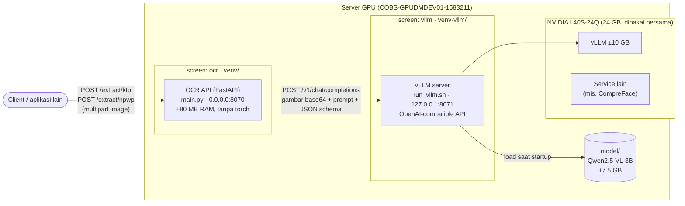
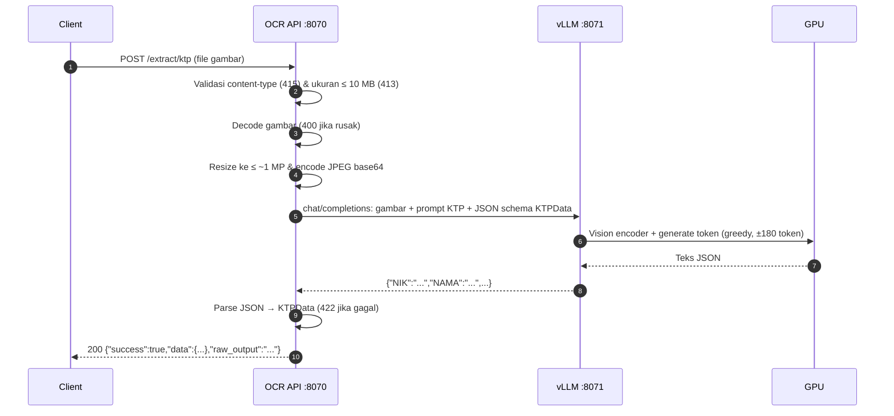
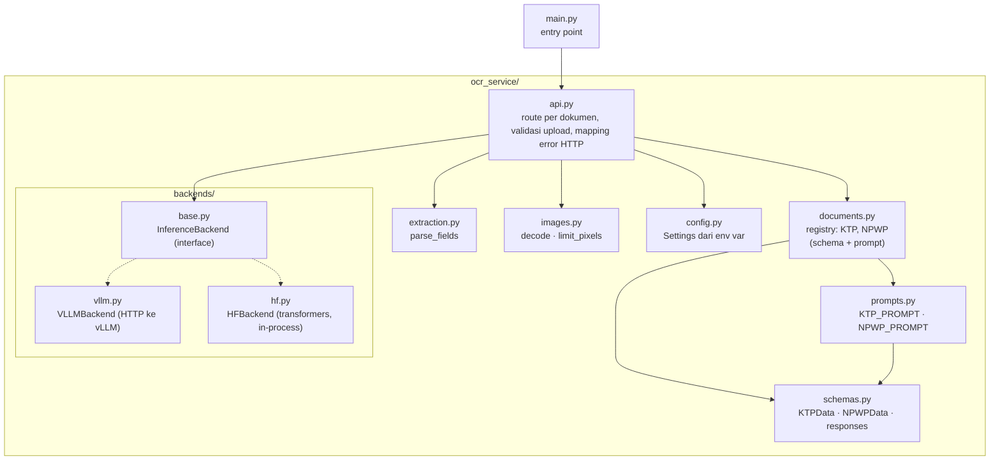
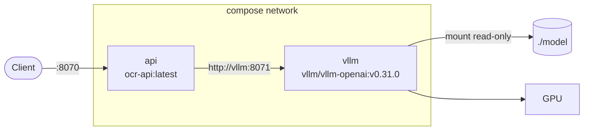

# OCR API (KTP & NPWP)

Service FastAPI untuk mengekstrak data terstruktur dari foto dokumen identitas Indonesia menggunakan model vision-language **Qwen2.5-VL-3B-Instruct**. Satu service, dibedakan per endpoint:

| Dokumen | Endpoint |
|---|---|
| KTP | `POST /extract/ktp` |
| NPWP | `POST /extract/npwp` |

```
                              ┌──────────────────────────┐      ┌───────────────────────────┐
 client ── /extract/ktp  ──►  │ OCR API :8070            │ ───► │ vLLM (Qwen2.5-VL) :8071   │ ── GPU
 client ── /extract/npwp ──►  │ main.py (screen "ocr")   │      │ run_vllm.sh (screen vllm) │
                              └──────────────────────────┘      └───────────────────────────┘
```

## Daftar isi

- [Quick start](#quick-start)
- [Arsitektur](#arsitektur)
- [Field yang diekstrak](#field-yang-diekstrak)
- [Prompt & batasan output](#prompt--batasan-output)
- [Prasyarat & instalasi](#prasyarat)
- [Menjalankan](#menjalankan-production-mode-vllm)
- [Docker](#docker)
- [Konfigurasi](#konfigurasi-api-environment-variable)
- [API](#api)
- [Struktur kode](#struktur-kode)
- [Troubleshooting](#troubleshooting)

## Quick start

Instalasi sudah ada di server (`venv/`, `venv-vllm/`, `model/`). Untuk menyalakan semuanya (mis. setelah reboot):

```bash
cd /data/ocr-qwen

# 1. Server model (vLLM) — tunggu ±1 menit sampai siap
screen -dmS vllm bash -c 'cd /data/ocr-qwen && ./run_vllm.sh 2>&1 | tee -a vllm.log'
until curl -sf localhost:8071/health; do sleep 3; done; echo "vLLM ready"

# 2. API
screen -dmS ocr bash -c 'cd /data/ocr-qwen && source venv/bin/activate && INFERENCE_BACKEND=vllm python main.py; exec bash'

# 3. Cek
curl localhost:8070/health
# {"status":"ok","backend":"vllm","model_loaded":true}
curl -F "file=@ktp.jpg;type=image/jpeg" localhost:8070/extract/ktp
```

## Arsitektur

### Deployment

Ada dua proses yang berjalan terpisah, masing-masing di GNU screen dan venv sendiri. API tidak memuat model; semua inference dikirim ke server vLLM, yang satu-satunya memakai GPU.



Poin penting:
- **vLLM hanya listen di `127.0.0.1`** — tidak bisa diakses dari luar server; hanya API (port 8070) yang terekspos.
- **vLLM mem-batch request bersamaan**, jadi beberapa request KTP/NPWP sekaligus selesai hampir secepat satu request.
- **Structured output:** vLLM dipaksa menghasilkan JSON sesuai schema dokumen, jadi output selalu JSON valid, semua key selalu ada, dan field seperti `JENIS_KELAMIN` atau `NIK` hanya bisa berisi nilai yang valid (lihat [Prompt & batasan output](#prompt--batasan-output)).
- Mode alternatif `hf` memuat model langsung di proses API (tanpa vLLM) — lihat [Mode HF](#mode-hf-tanpa-vllm).

### Alur request



Untuk NPWP alurnya sama, hanya prompt & schema yang berbeda (`NPWPData`).

### Lapisan kode



Backend dipilih sekali saat startup lewat `INFERENCE_BACKEND`. Backend tidak tahu soal KTP/NPWP — ia hanya menerima gambar, prompt, dan JSON schema — sehingga menambah jenis dokumen tidak perlu mengubah backend.

## Field yang diekstrak

**KTP:**

| Field | Keterangan | Nilai yang diizinkan (mode vLLM) |
|---|---|---|
| `NIK` | NIK di bawah header | Tepat 16 digit |
| `NAMA` | Nama lengkap sesuai cetakan | Bebas |
| `TTL` | Tempat/Tgl Lahir, mis. `JAKARTA, 17-08-1990` | Bebas |
| `JENIS_KELAMIN` | Jenis kelamin | `LAKI-LAKI`, `PEREMPUAN` |
| `GOL_DARAH` | Nilai setelah "Gol. Darah" di baris Jenis Kelamin | `A`, `B`, `AB`, `O` (boleh dengan `+`/`-`), `-` |
| `ALAMAT` | Baris "Alamat" saja, tanpa RT/RW, kelurahan, kecamatan | Bebas |
| `RT_RW` | Mis. `006/005` (tanpa spasi) | `N/N` s.d. `NNN/NNN` |
| `KEL_DESA` | Baris "Kel/Desa" | Bebas |
| `KECAMATAN` | Baris "Kecamatan" (bukan kabupaten/kota di header) | Bebas |
| `AGAMA` | Baris "Agama" | Bebas |
| `STATUS_PERKAWINAN` | Status perkawinan | `BELUM KAWIN`, `KAWIN`, `CERAI HIDUP`, `CERAI MATI` |
| `PEKERJAAN` | Pekerjaan sesuai cetakan | Bebas |
| `KEWARGANEGARAAN` | Biasanya `WNI` | Bebas |
| `BERLAKU_HINGGA` | Baris "Berlaku Hingga" (bukan tanggal terbit di bawah foto) | Bebas |

**NPWP:**

| Field | Keterangan | Nilai yang diizinkan (mode vLLM) |
|---|---|---|
| `NPWP` | Nomor NPWP sesuai cetakan | `NN.NNN.NNN.N-NNN.NNN` (kartu lama) atau 15–16 digit tanpa pemisah |
| `NAMA` | Nama wajib pajak (orang atau badan) | Bebas |
| `NIK` | NIK jika tercetak di kartu, selain itu `""` | Tepat 16 digit |
| `ALAMAT` | Alamat wajib pajak, semua baris digabung dengan spasi (tanpa nama KPP) | Bebas |
| `KPP` | Kantor Pelayanan Pajak penerbit, mis. `KPP PRATAMA JAKARTA SETIABUDI SATU` | Bebas |
| `TANGGAL_TERDAFTAR` | Tanggal terdaftar sesuai cetakan | Bebas |

Field yang tidak terbaca dikembalikan sebagai string kosong `""` (selalu diizinkan, juga untuk field yang dibatasi).

## Prompt & batasan output

Setiap dokumen punya prompt sendiri di `ocr_service/prompts.py` (`KTP_PROMPT`, `NPWP_PROMPT`). Prompt menjelaskan tata letak kartu dan aturan tiap field, karena itulah sumber salah baca yang paling sering:

- **KTP:** urutan baris di kartu disebutkan satu per satu. `Gol. Darah` sering kosong; tanpa penjelasan ini model mengisinya dengan nilai baris berikutnya sehingga `ALAMAT`, `RT_RW`, `KEL_DESA`, dst. ikut bergeser satu baris. Prompt juga menegaskan `BERLAKU_HINGGA` diambil dari baris "Berlaku Hingga", bukan dari kota/tanggal terbit di bawah foto.
- **NPWP:** menjelaskan format nomor lama dan baru, memisahkan alamat wajib pajak dari nama KPP, dan melarang menyalin nomor NPWP ke `NIK`.
- Keduanya meminta teks dibaca **persis sesuai cetakan** (tanpa koreksi ejaan) dan memberi petunjuk angka yang sering tertukar (`O`→`0`, `I`→`1`, `B`→`8`, `S`→`5`) untuk NIK/NPWP. Daftar key JSON di akhir prompt dibuat otomatis dari model data, jadi tidak bisa berbeda dari schema.

Selain prompt, JSON schema yang dikirim ke vLLM (`DocumentType.json_schema` di `documents.py`) membatasi output saat decoding:

- **Semua key wajib** (`required`), sehingga model tidak bisa melewatkan field.
- **Enum/pattern** untuk field dengan nilai terbatas (kolom terakhir tabel di atas), didefinisikan dengan `_constrained(...)` di `schemas.py`. Contoh: huruf yang rusak di kartu tidak lagi menghasilkan `PEREMPUA-J`, karena model hanya bisa memilih `LAKI-LAKI`, `PEREMPUAN`, atau `""`.

Batasan ini **hanya berlaku di mode vLLM**. Pydantic tidak memvalidasinya, jadi mode `hf` (tanpa constrained decoding) tetap mengembalikan apa pun yang dibaca model, bukan error.

**Mengubah prompt:** edit `prompts.py`, lalu restart API saja (`screen -r ocr` → Ctrl-C → `INFERENCE_BACKEND=vllm python main.py`). vLLM tidak perlu di-restart. Sebaiknya uji dulu dengan beberapa foto asli dan bandingkan hasil sebelum/sesudah, karena perubahan kecil (mis. contoh `JL. MERDEKA` di prompt) bisa membuat model ikut "mengoreksi" teks seperti `JL KECAPI V` menjadi `JL. KECAPI V`.

## Prasyarat

- Python 3.10, GPU NVIDIA (server ini: L40S-24Q vGPU, 24 GB, **dipakai bersama**)
- Bobot model di `model/` (±7.5 GB). Jika folder kosong, mode `hf` akan mengunduh `Qwen/Qwen2.5-VL-3B-Instruct` dari HuggingFace dan menyimpannya di sini.
- [`uv`](https://github.com/astral-sh/uv) (sudah terpasang di `~/.local/bin/uv`)

## Instalasi

Hanya perlu sekali (sudah dilakukan di server ini). Ada **dua venv terpisah** supaya versi torch milik vLLM tidak bentrok dengan API:

```bash
cd /data/ocr-qwen

# 1. API (venv/). requirements-hf.txt = dependency dasar + torch/transformers untuk mode hf
uv venv venv --python 3.10
VIRTUAL_ENV=venv uv pip install -r requirements-hf.txt

# 2. Server vLLM (venv-vllm/, ±8 GB)
uv venv venv-vllm --python 3.10
VIRTUAL_ENV=venv-vllm uv pip install vllm
```

## Menjalankan (production: mode vLLM)

Urutan: **vLLM dulu, baru API.** (Ringkasannya ada di [Quick start](#quick-start).)

```bash
# 1. Server vLLM di screen "vllm" (log juga ditulis ke vllm.log)
screen -dmS vllm bash -c 'cd /data/ocr-qwen && ./run_vllm.sh 2>&1 | tee -a vllm.log'

# 2. Tunggu siap (±1 menit)
until curl -sf localhost:8071/health; do sleep 3; done; echo vLLM ready

# 3. API di screen "ocr" (interaktif)
screen -S ocr
cd /data/ocr-qwen && source venv/bin/activate
INFERENCE_BACKEND=vllm python main.py
# lepas dari screen: Ctrl-A lalu D

# 4. Cek
curl localhost:8070/health
```

### Melihat status & log

```bash
screen -ls                         # harus ada: vllm, ocr
screen -r ocr                      # log API (lepas: Ctrl-A lalu D)
screen -r vllm                     # log vLLM, atau: tail -f vllm.log
curl localhost:8070/health         # status API + koneksi ke vLLM
nvidia-smi                         # pemakaian GPU (vLLM ±10 GB)
```

### Restart

| Yang di-restart | Cara | Dampak |
|---|---|---|
| API saja (mis. setelah ubah kode) | `screen -r ocr` → Ctrl-C → `INFERENCE_BACKEND=vllm python main.py` | Downtime beberapa detik |
| vLLM | `screen -S vllm -X quit`, lalu langkah 1–2 di atas | Semua endpoint tidak bisa inference ±1 menit |
| Semua (mis. setelah reboot) | [Quick start](#quick-start) | — |

### Mode HF (tanpa vLLM)

Model dimuat langsung di proses API. Lebih sederhana, tapi request diproses satu per satu dan tidak ada structured output.

```bash
screen -S vllm -X quit        # matikan vLLM dulu, GPU tidak cukup untuk keduanya
pip install -r requirements-hf.txt   # sekali saja: torch/transformers tidak terpasang di venv/
INFERENCE_BACKEND=hf python main.py
```

## Docker

Alternatif dari setup screen di atas: dua container lewat Docker Compose.

| Service | Image | Port | Keterangan |
|---|---|---|---|
| `api` | `ocr-api:latest`, dibangun dari `Dockerfile` (±260 MB) | `8070` (dipublish) | Mode vLLM, tanpa torch, user non-root, ada healthcheck |
| `vllm` | `vllm/vllm-openai:v0.31.0` (±9 GB terkompresi) | `8071` (hanya di network compose) | Flag sama dengan `run_vllm.sh`; `model/` di-mount read-only |



### Prasyarat

- NVIDIA Container Toolkit (sudah terpasang di server ini).
- **Ruang disk Docker ±25 GB** untuk image vLLM. Di server ini Docker root ada di `/` yang sisa ±14 GB, jadi **tidak cukup**. Kosongkan ruang atau pindahkan `data-root` Docker ke `/data` dulu.
- Hentikan setup screen sebelum menjalankan compose. Port 8070 bentrok, dan GPU tidak cukup untuk dua vLLM:
  ```bash
  screen -S ocr -X quit; screen -S vllm -X quit
  ```

### Menjalankan

```bash
cd /data/ocr-qwen
docker compose up -d --build        # api baru start setelah vllm healthy (±1–5 menit)
docker compose ps                   # kedua service harus "healthy"
curl localhost:8070/health
docker compose logs -f api          # log API
docker compose logs -f vllm         # log vLLM
docker compose down                 # stop semua
```

Variabel opsional (shell atau file `.env`):

| Variable | Default | Keterangan |
|---|---|---|
| `API_PORT` | `8070` | Port host untuk API |
| `VLLM_GPU_UTIL` | `0.40` | Porsi memori GPU untuk vLLM |
| `VLLM_EAGER` | `enforce-eager` | `no-enforce-eager` untuk mencoba CUDA graphs (lebih cepat, butuh memori lebih) |

### Hanya image API

Image API bisa dipakai sendiri dengan vLLM yang sudah jalan di host (setup screen):

```bash
docker build -t ocr-api:latest .
docker run -d --name ocr-api --network host \
  -e VLLM_URL=http://127.0.0.1:8071 -e PORT=8070 ocr-api:latest
```

## Catatan server vLLM (`run_vllm.sh`)

- Memakai ±10 GB GPU (`--gpu-memory-utilization 0.40`). Ubah dengan `VLLM_GPU_UTIL=0.35 ./run_vllm.sh`.
- Berjalan dengan `--enforce-eager` karena server ini **tidak punya `nvcc`** (CUDA toolkit). Tanpa flag itu vLLM crash saat startup dengan `Could not find nvcc`. Jika CUDA toolkit sudah dipasang, mode lebih cepat bisa dicoba dengan `VLLM_EXTRA_ARGS="" ./run_vllm.sh`.
- Hanya listen di `127.0.0.1` — tidak diekspos ke jaringan.
- Maksimal 8 request diproses bersamaan (`--max-num-seqs 8`); sisanya antre di vLLM.
- Resolusi gambar dibatasi ±1 MP (`--mm-processor-kwargs`). Ubah bersamaan dengan `MAX_PIXELS` di API.

## Konfigurasi API (environment variable)

| Variable | Default | Keterangan |
|---|---|---|
| `INFERENCE_BACKEND` | `vllm` | `vllm` (production) atau `hf` |
| `HOST` | `0.0.0.0` | Alamat bind API |
| `PORT` | `8070` | Port API |
| `VLLM_URL` | `http://127.0.0.1:8071` | Alamat server vLLM |
| `VLLM_MODEL` | `qwen-ktp` | Nama model di server vLLM (`--served-model-name`) |
| `VLLM_TIMEOUT` | `120` | Timeout request ke vLLM (detik) |
| `MIN_PIXELS` / `MAX_PIXELS` | `200704` / `1003520` | Batas resolusi gambar. Naikkan `MAX_PIXELS` jika teks kecil salah baca |

## API

Dokumentasi interaktif (Swagger): `http://<host>:8070/docs`

Semua endpoint `POST /extract/{dokumen}` menerima upload gambar (`image/jpeg`, `image/png`, `image/webp`, maks 10 MB) sebagai multipart field `file`, dan mengembalikan format yang sama: `{"success", "data", "raw_output"}`.

### `POST /extract/ktp`

```bash
curl -F "file=@ktp.jpg;type=image/jpeg" http://localhost:8070/extract/ktp
```

Response:
```json
{
  "success": true,
  "data": {
    "NIK": "3174010000000901",
    "NAMA": "BUDI SANTOSO",
    "TTL": "JAKARTA, 17-08-1990",
    "JENIS_KELAMIN": "LAKI-LAKI",
    "GOL_DARAH": "O",
    "ALAMAT": "JL. MERDEKA NO. 10",
    "RT_RW": "000/007",
    "KEL_DESA": "KEBAYORAN",
    "KECAMATAN": "KEBAYORAN BARU",
    "AGAMA": "ISLAM",
    "STATUS_PERKAWINAN": "KAWIN",
    "PEKERJAAN": "KARYAWAN SWASTA",
    "KEWARGANEGARAAN": "WNI",
    "BERLAKU_HINGGA": "SEUMUR HIDUP"
  },
  "raw_output": "{\"NIK\":\"3174010000000901\", ...}"
}
```

### `POST /extract/npwp`

```bash
curl -F "file=@npwp.jpg;type=image/jpeg" http://localhost:8070/extract/npwp
```

Response:
```json
{
  "success": true,
  "data": {
    "NPWP": "01.234.567.8-901.000",
    "NIK": "",
    "NAMA": "BUDI SANTOSO",
    "ALAMAT": "JL. MERDEKA NO. 10 RT 001 RW 002 KEBAYORAN BARU JAKARTA SELATAN",
    "KPP": "KPP PRATAMA JAKARTA KEBAYORAN BARU SATU",
    "TANGGAL_TERDAFTAR": "12/03/2015"
  },
  "raw_output": "{\"NPWP\":\"01.234.567.8-901.000\", ...}"
}
```

### Kode HTTP

| HTTP | Arti |
|---|---|
| 200 | Berhasil |
| 400 | File bukan gambar yang valid |
| 404 | Jenis dokumen tidak dikenal (mis. `/extract/sim`) |
| 413 | File lebih dari 10 MB |
| 415 | Content-type bukan JPEG/PNG/WebP |
| 422 | Output model tidak bisa di-parse sebagai JSON (praktis tidak terjadi di mode vLLM) |
| 500 | Error inference (mis. vLLM mati) |

### `GET /health`

`status` = `ok` jika backend siap, `degraded` jika vLLM tidak bisa dihubungi.

## Performa (referensi, gambar sintetis)

| Skenario | Waktu |
|---|---|
| 1 request KTP, mode vLLM | ±7 detik |
| 1 request NPWP, mode vLLM | ±4.5–5 detik (field lebih sedikit) |
| 4 request bersamaan (2 KTP + 2 NPWP), mode vLLM | ±7.5 detik total (di-batch) |
| 1 request, mode HF | ±6.6–6.9 detik |
| 4 request bersamaan, mode HF | ±26 detik (antre) |

Bottleneck utama adalah kecepatan generate token di vGPU, bukan ukuran gambar.

## Struktur kode

```
main.py                 entry point (python main.py / uvicorn main:app)
run_vllm.sh             server vLLM (setup screen)
Dockerfile              image API (mode vLLM)
docker-compose.yml      api + vllm
requirements.txt        dependency dasar (mode vLLM, dipakai Dockerfile)
requirements-hf.txt     + torch/transformers untuk mode hf
model/                  bobot Qwen2.5-VL-3B (±7.5 GB)
ocr_service/
├── config.py           Settings dari environment variable
├── schemas.py          KTPData, NPWPData, response models
├── documents.py        registry jenis dokumen (KTP, NPWP): schema + prompt
├── prompts.py          prompt khusus per dokumen (layout kartu + aturan per field)
├── extraction.py       parsing output model
├── images.py           decode & resize gambar
├── api.py              route FastAPI (1 endpoint per dokumen) & mapping error HTTP
└── backends/
    ├── base.py         interface InferenceBackend
    ├── hf.py           transformers (in-process)
    └── vllm.py         klien ke server vLLM (structured JSON output)
backup/                 versi kode sebelumnya (untuk rollback)
```

### Menambah field atau jenis dokumen baru

- **Field baru:** tambahkan di model data (`KTPData` / `NPWPData` di `schemas.py`; pakai `_constrained(enum=...)` atau `_constrained(pattern=...)` jika nilainya terbatas), lalu tambahkan aturan field-nya di `prompts.py`. Daftar key JSON di prompt dan JSON schema vLLM ikut ter-update otomatis.
- **Dokumen baru** (mis. SIM): buat `SIMData` + `SIMResponse` di `schemas.py` dan `SIM_PROMPT` di `prompts.py`, lalu daftarkan `DocumentType` baru di `documents.py` dan tambahkan ke `DOCUMENTS`. Endpoint `POST /extract/sim` otomatis tersedia setelah restart API (vLLM tidak perlu di-restart).

### Rollback

Versi lama hanya punya endpoint KTP (tanpa `/extract/npwp`).

```bash
cp backup/main_single_file_vllm.py main.py   # versi 1 file dengan dukungan vLLM
cp backup/main_original_hf.py main.py        # versi asli (HF saja — matikan vLLM dulu)
```
Lalu restart API. (`backup/ktp_ocr_package/` = versi package KTP-only sebelum digabung dengan NPWP.)

## Troubleshooting

| Gejala | Penyebab / solusi |
|---|---|
| `/health` → `degraded` | vLLM mati. Cek `screen -r vllm` / `tail vllm.log`, lalu jalankan ulang |
| vLLM: `Free memory on device ... is less than desired` | GPU dipakai proses lain (`nvidia-smi`). Turunkan `VLLM_GPU_UTIL` atau hentikan proses lain |
| vLLM: `No available memory for the cache blocks` | `VLLM_GPU_UTIL` terlalu kecil untuk bobot model (±7.5 GB); naikkan sedikit |
| vLLM: `Could not find nvcc` | Pastikan `--enforce-eager` aktif (default di `run_vllm.sh`) |
| Field salah baca pada foto buram/kecil | Naikkan `MAX_PIXELS` (API) dan `max_pixels` di `run_vllm.sh` |
| Field KTP bergeser satu baris atau diambil dari tempat yang salah | Perjelas aturan field tersebut di `prompts.py`, lalu restart API (lihat [Prompt & batasan output](#prompt--batasan-output)) |
| Field selalu `""` padahal terbaca jelas | Nilai di kartu tidak cocok dengan enum/pattern di `schemas.py` (mis. format NPWP baru). Longgarkan batasannya, lalu restart API |
| `Address already in use` | Port dipakai proses lain: `ss -ltnp \| grep 807` |
