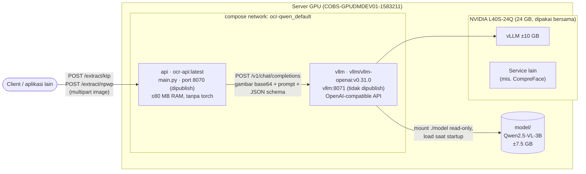
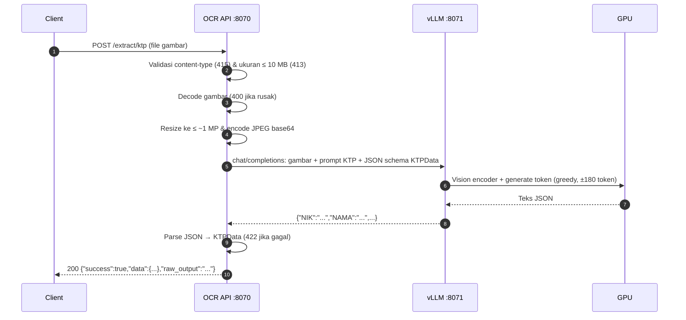
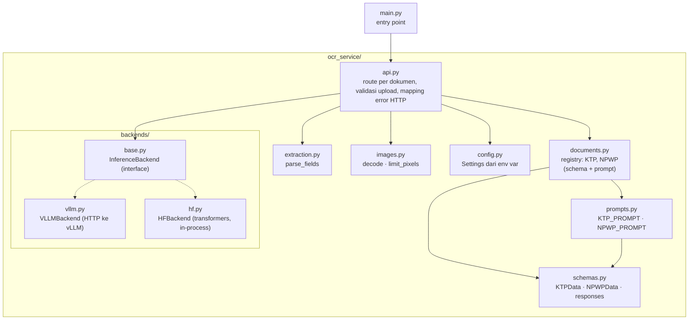

# OCR API (KTP, NPWP & Kartu Keluarga)

Service FastAPI untuk mengekstrak data terstruktur dari foto dokumen identitas Indonesia menggunakan model vision-language **Qwen2.5-VL-3B-Instruct**. Satu service, dibedakan per endpoint:

| Dokumen | Endpoint |
|---|---|
| KTP | `POST /extract/ktp` |
| NPWP | `POST /extract/npwp` |
| Kartu Keluarga (KK) | `POST /extract/kk` |

```
                              ┌────────────────────────────┐      ┌─────────────────────────────┐
 client ── /extract/ktp  ──►  │ OCR API :8070              │ ───► │ vLLM (Qwen2.5-VL) :8071     │ ── GPU
 client ── /extract/npwp ──►  │ container ocr-qwen-api-1   │      │ container ocr-qwen-vllm-1   │
 client ── /extract/kk   ──►  │                            │      │                             │
                              └────────────────────────────┘      └─────────────────────────────┘
```

📖 **Dokumentasi lengkap:** https://sivi-shahab.github.io/OCR-KTP-NPWP/ (sumber di `docs/`, VitePress).

Production berjalan dengan **Docker Compose** (`docker-compose.yml`). Setup lama dengan GNU screen masih bisa dipakai sebagai [alternatif tanpa Docker](#alternatif-setup-screen-tanpa-docker).

## Daftar isi

- [Quick start](#quick-start)
- [Arsitektur](#arsitektur)
- [Field yang diekstrak](#field-yang-diekstrak)
- [Prompt & batasan output](#prompt--batasan-output)
- [Deployment: Docker Compose](#deployment-docker-compose)
- [Alternatif: setup screen](#alternatif-setup-screen-tanpa-docker)
- [Konfigurasi](#konfigurasi-api-environment-variable)
- [API](#api)
- [Struktur kode](#struktur-kode)
- [Troubleshooting](#troubleshooting)

## Quick start

Image dan bobot model (`model/`) sudah ada di server. Container memakai restart policy `unless-stopped`, jadi setelah reboot server keduanya naik sendiri. Untuk menyalakan secara manual:

```bash
cd /data/ocr-qwen
docker compose up -d                # api baru start setelah vllm healthy (±1–5 menit)
docker compose ps                   # kedua service harus "healthy", api punya PORTS 0.0.0.0:8070

# Cek
curl localhost:8070/health
# {"status":"ok","backend":"vllm","model_loaded":true}
curl -H "X-API-Key: <key>" -F "file=@ktp.jpg;type=image/jpeg" localhost:8070/extract/ktp
```

Key ada di `API_KEYS` dalam file `.env` (lihat [Autentikasi](#autentikasi-x-api-key)).

Dari aplikasi lain: `http://10.168.105.11:8070/extract/ktp` dan `http://10.168.105.11:8070/extract/npwp`.

## Arsitektur

### Deployment

Ada dua container dalam satu network compose. API tidak memuat model; semua inference dikirim ke container vLLM, yang satu-satunya memakai GPU.



Poin penting:
- **Port vLLM (8071) tidak dipublish** — hanya bisa diakses dari dalam network compose (`http://vllm:8071`); hanya API (port 8070) yang terekspos.
- **vLLM mem-batch request bersamaan**, jadi beberapa request KTP/NPWP sekaligus selesai hampir secepat satu request.
- **Structured output:** vLLM dipaksa menghasilkan JSON sesuai schema dokumen, jadi output selalu JSON valid, semua key selalu ada, dan field seperti `JENIS_KELAMIN` atau `NIK` hanya bisa berisi nilai yang valid (lihat [Prompt & batasan output](#prompt--batasan-output)).
- Mode alternatif `hf` memuat model langsung di proses API (tanpa vLLM) — lihat [Mode HF](#mode-hf-tanpa-vllm).

### Alur request



Untuk NPWP alurnya sama, hanya prompt & schema yang berbeda (`NPWPData`).

### Lapisan kode



Backend dipilih sekali saat startup lewat `INFERENCE_BACKEND`. Backend tidak tahu soal KTP/NPWP — ia hanya menerima gambar, prompt, dan JSON schema — sehingga menambah jenis dokumen tidak perlu mengubah backend.

## Field yang diekstrak

**KTP:**

| Field | Keterangan | Nilai yang diizinkan (mode vLLM) |
|---|---|---|
| `NIK` | NIK di bawah header | Tepat 16 digit |
| `NAMA` | Nama lengkap sesuai cetakan | Bebas |
| `TTL` | Tempat/Tgl Lahir, mis. `JAKARTA, 17-08-1990` | Bebas |
| `JENIS_KELAMIN` | Jenis kelamin | `LAKI-LAKI`, `PEREMPUAN` |
| `GOL_DARAH` | Nilai setelah "Gol. Darah" di baris Jenis Kelamin | `A`, `B`, `AB`, `O` (boleh dengan `+`/`-`), `-` |
| `ALAMAT` | Baris "Alamat" saja, tanpa RT/RW, kelurahan, kecamatan | Bebas |
| `RT_RW` | Mis. `006/005` (tanpa spasi) | `N/N` s.d. `NNN/NNN` |
| `KEL_DESA` | Baris "Kel/Desa" | Bebas |
| `KECAMATAN` | Baris "Kecamatan" (bukan kabupaten/kota di header) | Bebas |
| `AGAMA` | Baris "Agama" | Bebas |
| `STATUS_PERKAWINAN` | Status perkawinan | `BELUM KAWIN`, `KAWIN`, `CERAI HIDUP`, `CERAI MATI` |
| `PEKERJAAN` | Pekerjaan sesuai cetakan | Bebas |
| `KEWARGANEGARAAN` | Biasanya `WNI` | Bebas |
| `BERLAKU_HINGGA` | Baris "Berlaku Hingga" (bukan tanggal terbit di bawah foto) | Bebas |

**NPWP:**

| Field | Keterangan | Nilai yang diizinkan (mode vLLM) |
|---|---|---|
| `NPWP` | Nomor NPWP sesuai cetakan | `NN.NNN.NNN.N-NNN.NNN` (kartu lama) atau 15–16 digit tanpa pemisah |
| `NAMA` | Nama wajib pajak (orang atau badan) | Bebas |
| `NIK` | NIK jika tercetak di kartu, selain itu `""` | Tepat 16 digit |
| `ALAMAT` | Alamat wajib pajak, semua baris digabung dengan spasi (tanpa nama KPP) | Bebas |
| `KPP` | Kantor Pelayanan Pajak penerbit, mis. `KPP PRATAMA JAKARTA SETIABUDI SATU` | Bebas |
| `TANGGAL_TERDAFTAR` | Tanggal terdaftar sesuai cetakan | Bebas |

**Kartu Keluarga (KK):** field header, ditambah `ANGGOTA_KELUARGA` = list berisi satu objek per anggota keluarga (baris tabel atas dan bawah dengan nomor yang sama digabung).

| Field header | Keterangan | Nilai yang diizinkan (mode vLLM) |
|---|---|---|
| `NO_KK` | Nomor KK di bawah judul | Tepat 16 digit |
| `NAMA_KEPALA_KELUARGA`, `ALAMAT`, `DESA_KELURAHAN`, `KECAMATAN`, `KABUPATEN_KOTA`, `PROVINSI` | Baris header dengan label tersebut | Bebas |
| `RT_RW` | Mis. `003/005` | `N/N` s.d. `NNN/NNN` |
| `KODE_POS` | Kode pos | Tepat 5 digit |
| `TANGGAL_DIKELUARKAN` | "Dikeluarkan Tanggal" di bagian bawah | Bebas |

| Field anggota | Keterangan | Nilai yang diizinkan (mode vLLM) |
|---|---|---|
| `NIK` | NIK anggota | Tepat 16 digit |
| `JENIS_KELAMIN` | Jenis kelamin | `LAKI-LAKI`, `PEREMPUAN` |
| `TANGGAL_LAHIR` | Tanggal lahir | `DD-MM-YYYY` |
| `NAMA_LENGKAP`, `TEMPAT_LAHIR`, `AGAMA`, `PENDIDIKAN`, `JENIS_PEKERJAAN`, `GOLONGAN_DARAH` | Kolom tabel atas | Bebas |
| `STATUS_PERKAWINAN`, `TANGGAL_PERKAWINAN`, `STATUS_HUBUNGAN_DALAM_KELUARGA`, `KEWARGANEGARAAN`, `NO_PASPOR`, `NO_KITAP`, `NAMA_AYAH`, `NAMA_IBU` | Kolom tabel bawah | Bebas |

KK berupa lembar A4 dengan teks tabel kecil dan output yang panjang, jadi `documents.py` memberinya batas sendiri: gambar sampai `2508800` piksel (bukan `1003520` seperti kartu) dan `3072` token output. Karena itu vLLM dijalankan dengan `--max-model-len 8192` dan `max_pixels` `2508800`; KTP/NPWP tetap diperkecil ke `MAX_PIXELS` oleh API sebelum dikirim, jadi kecepatannya tidak berubah. Satu request KK jauh lebih lambat dari KTP (±30 detik untuk 3 anggota, bertambah per anggota).

Field yang tidak terbaca dikembalikan sebagai string kosong `""` (selalu diizinkan, juga untuk field yang dibatasi).

## Prompt & batasan output

Setiap dokumen punya prompt sendiri di `ocr_service/prompts.py` (`KTP_PROMPT`, `NPWP_PROMPT`, `KK_PROMPT`). Prompt menjelaskan tata letak kartu dan aturan tiap field, karena itulah sumber salah baca yang paling sering:

- **KTP:** urutan baris di kartu disebutkan satu per satu. `Gol. Darah` sering kosong; tanpa penjelasan ini model mengisinya dengan nilai baris berikutnya sehingga `ALAMAT`, `RT_RW`, `KEL_DESA`, dst. ikut bergeser satu baris. Prompt juga menegaskan `BERLAKU_HINGGA` diambil dari baris "Berlaku Hingga", bukan dari kota/tanggal terbit di bawah foto.
- **NPWP:** menjelaskan format nomor lama dan baru, memisahkan alamat wajib pajak dari nama KPP, dan melarang menyalin nomor NPWP ke `NIK`.
- **KK:** menjelaskan header dan kedua tabel anggota, dan meminta baris N tabel atas digabung dengan baris N tabel bawah menjadi satu anggota, tanpa menggeser nilai ke baris/kolom tetangga.
- Semuanya meminta teks dibaca **persis sesuai cetakan** (tanpa koreksi ejaan) dan memberi petunjuk angka yang sering tertukar (`O`→`0`, `I`→`1`, `B`→`8`, `S`→`5`) untuk NIK/NPWP. Daftar key JSON di akhir prompt dibuat otomatis dari model data, jadi tidak bisa berbeda dari schema.

Selain prompt, JSON schema yang dikirim ke vLLM (`DocumentType.json_schema` di `documents.py`) membatasi output saat decoding:

- **Semua key wajib** (`required`), sehingga model tidak bisa melewatkan field.
- **Enum/pattern** untuk field dengan nilai terbatas (kolom terakhir tabel di atas), didefinisikan dengan `_constrained(...)` di `schemas.py`. Contoh: huruf yang rusak di kartu tidak lagi menghasilkan `PEREMPUA-J`, karena model hanya bisa memilih `LAKI-LAKI`, `PEREMPUAN`, atau `""`.

Batasan ini **hanya berlaku di mode vLLM**. Pydantic tidak memvalidasinya, jadi mode `hf` (tanpa constrained decoding) tetap mengembalikan apa pun yang dibaca model, bukan error.

**Mengubah prompt:** edit `prompts.py`, lalu build ulang dan restart API saja: `docker compose up -d --build api`. Kode di-copy ke dalam image, jadi tanpa `--build` perubahan tidak terpakai. vLLM tidak perlu di-restart. Sebaiknya uji dulu dengan beberapa foto asli dan bandingkan hasil sebelum/sesudah, karena perubahan kecil (mis. contoh `JL. MERDEKA` di prompt) bisa membuat model ikut "mengoreksi" teks seperti `JL KECAPI V` menjadi `JL. KECAPI V`.

## Deployment: Docker Compose

Setup production. Dua container didefinisikan di `docker-compose.yml`:

| Service | Container | Image | Port | Keterangan |
|---|---|---|---|---|
| `api` | `ocr-qwen-api-1` | `ocr-api:latest`, dibangun dari `Dockerfile` (±260 MB) | `8070` (dipublish) | Mode vLLM, tanpa torch, user non-root, ada healthcheck |
| `vllm` | `ocr-qwen-vllm-1` | `vllm/vllm-openai:v0.31.0` | `8071` (hanya di network compose) | Flag sama dengan `run_vllm.sh`; `model/` di-mount read-only |

Keduanya memakai `restart: unless-stopped`, jadi ikut naik lagi setelah reboot server atau crash. `api` baru start setelah healthcheck `vllm` lolos (`depends_on: condition: service_healthy`).

### Prasyarat

- NVIDIA Container Toolkit (sudah terpasang di server ini).
- Image `vllm/vllm-openai:v0.31.0` sudah di-pull. Docker root ada di `/var/lib/docker` (partisi `/`, sisa ±15 GB), jadi pantau ruang disk sebelum pull image versi lain.
- Setup screen **tidak boleh jalan bersamaan**. Port 8070 bentrok, dan GPU tidak cukup untuk dua vLLM:
  ```bash
  screen -S ocr -X quit; screen -S vllm -X quit
  ```

### Menjalankan & menghentikan

```bash
cd /data/ocr-qwen
docker compose up -d --build        # build image api (jika berubah) lalu start semua
docker compose ps                   # kedua service harus "healthy"
curl localhost:8070/health
docker compose down                 # stop & hapus kedua container (image dan model tetap ada)
```

### Melihat status & log

```bash
docker compose ps                   # status + health; api harus punya PORTS 0.0.0.0:8070->8070
docker compose logs -f api          # log API
docker compose logs -f vllm         # log vLLM
docker compose logs --tail 100 vllm # 100 baris terakhir
curl localhost:8070/health          # status API + koneksi ke vLLM
nvidia-smi                          # pemakaian GPU (vLLM ±10 GB)
```

### Restart & update

| Yang di-restart | Cara | Dampak |
|---|---|---|
| API setelah ubah kode/prompt | `docker compose up -d --build api` | Downtime beberapa detik |
| API saja, tanpa perubahan kode | `docker compose restart api` | Downtime beberapa detik |
| API dibuat ulang (mis. container kehilangan network) | `docker compose up -d --force-recreate --no-deps api` | Downtime beberapa detik |
| vLLM (mis. ubah flag di `docker-compose.yml`) | `docker compose up -d vllm` | Inference tidak tersedia ±1–5 menit |
| Semua | `docker compose down && docker compose up -d` | Inference tidak tersedia ±1–5 menit |

`--no-deps` membuat container vLLM tidak ikut di-restart, sehingga model tidak perlu dimuat ulang.

### Variabel opsional

Semua variabel didokumentasikan di [`.env.example`](.env.example). Untuk setup baru:

```bash
cp .env.example .env && chmod 600 .env   # lalu isi API_KEYS
```

`.env` dibaca oleh `docker-compose.yml`, `run_vllm.sh`, dan `main.py`; variabel yang sudah diset di shell menang atas `.env`. File ini masuk `.gitignore` dan `.dockerignore`, jadi tidak pernah di-commit atau ikut masuk image.

Variabel Docker Compose:

| Variable | Default | Keterangan |
|---|---|---|
| `API_KEYS` | kosong | Key untuk header `X-API-Key`, dipisah koma. Kosong = autentikasi mati |
| `API_PORT` | `8070` | Port host untuk API |
| `VLLM_GPU_UTIL` | `0.40` | Porsi memori GPU untuk vLLM |
| `VLLM_EAGER` | `enforce-eager` | `no-enforce-eager` untuk mencoba CUDA graphs (lebih cepat, butuh memori lebih) |
| `VLLM_MODEL` | `qwen-ktp` | Dipakai untuk `--served-model-name` vLLM **dan** API, sehingga selalu sama |
| `VLLM_MAX_MODEL_LEN` | `8192` | `--max-model-len` vLLM |
| `VLLM_MAX_NUM_SEQS` | `8` | Maksimal request diproses bersamaan di vLLM |
| `VLLM_IMAGE` | `vllm/vllm-openai:v0.31.0` | Image Docker vLLM |

Variabel API (lihat [Konfigurasi](#konfigurasi-api-environment-variable)) yang diteruskan ke container ada di bagian `environment:` service `api`; tambahkan di sana jika perlu variabel lain.

### Hanya image API

Image API bisa dipakai sendiri dengan vLLM yang jalan di host (setup screen):

```bash
docker build -t ocr-api:latest .
docker run -d --name ocr-api --network host \
  -e VLLM_URL=http://127.0.0.1:8071 -e PORT=8070 ocr-api:latest
```

## Alternatif: setup screen (tanpa Docker)

Setup production sebelum Docker Compose: dua proses di GNU screen, masing-masing dengan venv sendiri. Matikan compose dulu (`docker compose down`) sebelum memakai cara ini.

### Prasyarat

- Python 3.10, GPU NVIDIA (server ini: L40S-24Q vGPU, 24 GB, **dipakai bersama**)
- Bobot model di `model/` (±7.5 GB). Jika folder kosong, mode `hf` akan mengunduh `Qwen/Qwen2.5-VL-3B-Instruct` dari HuggingFace dan menyimpannya di sini.
- [`uv`](https://github.com/astral-sh/uv) (sudah terpasang di `~/.local/bin/uv`)

### Instalasi

Hanya perlu sekali (sudah dilakukan di server ini). Ada **dua venv terpisah** supaya versi torch milik vLLM tidak bentrok dengan API:

```bash
cd /data/ocr-qwen

# 1. API (venv/). requirements-hf.txt = dependency dasar + torch/transformers untuk mode hf
uv venv venv --python 3.10
VIRTUAL_ENV=venv uv pip install -r requirements-hf.txt

# 2. Server vLLM (venv-vllm/, ±8 GB)
uv venv venv-vllm --python 3.10
VIRTUAL_ENV=venv-vllm uv pip install vllm
```

### Menjalankan

Urutan: **vLLM dulu, baru API.**

```bash
# 1. Server vLLM di screen "vllm" (log juga ditulis ke vllm.log)
screen -dmS vllm bash -c 'cd /data/ocr-qwen && ./run_vllm.sh 2>&1 | tee -a vllm.log'

# 2. Tunggu siap (±1 menit)
until curl -sf localhost:8071/health; do sleep 3; done; echo vLLM ready

# 3. API di screen "ocr" (interaktif)
screen -S ocr
cd /data/ocr-qwen && source venv/bin/activate
INFERENCE_BACKEND=vllm python main.py
# lepas dari screen: Ctrl-A lalu D

# 4. Cek
curl localhost:8070/health
```

#### Melihat status & log

```bash
screen -ls                         # harus ada: vllm, ocr
screen -r ocr                      # log API (lepas: Ctrl-A lalu D)
screen -r vllm                     # log vLLM, atau: tail -f vllm.log
curl localhost:8070/health         # status API + koneksi ke vLLM
nvidia-smi                         # pemakaian GPU (vLLM ±10 GB)
```

#### Restart

| Yang di-restart | Cara | Dampak |
|---|---|---|
| API saja (mis. setelah ubah kode) | `screen -r ocr` → Ctrl-C → `INFERENCE_BACKEND=vllm python main.py` | Downtime beberapa detik |
| vLLM | `screen -S vllm -X quit`, lalu langkah 1–2 di atas | Semua endpoint tidak bisa inference ±1 menit |
| Semua (mis. setelah reboot) | Langkah 1–4 di atas | — |

#### Mode HF (tanpa vLLM)

Model dimuat langsung di proses API. Lebih sederhana, tapi request diproses satu per satu dan tidak ada structured output.

```bash
screen -S vllm -X quit        # matikan vLLM dulu, GPU tidak cukup untuk keduanya
pip install -r requirements-hf.txt   # sekali saja: torch/transformers tidak terpasang di venv/
INFERENCE_BACKEND=hf python main.py
```

## Catatan server vLLM

Flag vLLM di `docker-compose.yml` (service `vllm`) sama dengan di `run_vllm.sh`. Jika mengubah salah satunya, samakan yang lain.

- Memakai ±10 GB GPU (`--gpu-memory-utilization 0.40`). Ubah dengan `VLLM_GPU_UTIL=0.35` (compose: di `.env`, lalu `docker compose up -d vllm`; screen: `VLLM_GPU_UTIL=0.35 ./run_vllm.sh`).
- Berjalan dengan `--enforce-eager` karena server ini **tidak punya `nvcc`** (CUDA toolkit). Tanpa flag itu vLLM crash saat startup dengan `Could not find nvcc`. Mode CUDA graphs yang lebih cepat bisa dicoba dengan `VLLM_EAGER=no-enforce-eager` (compose) atau `VLLM_EXTRA_ARGS="" ./run_vllm.sh` (screen).
- Tidak diekspos ke jaringan: di compose port 8071 tidak dipublish, di setup screen hanya listen di `127.0.0.1`.
- Maksimal 8 request diproses bersamaan (`--max-num-seqs 8`); sisanya antre di vLLM.
- Resolusi gambar dibatasi ±1 MP (`--mm-processor-kwargs`). Ubah bersamaan dengan `MAX_PIXELS` di API.

## Konfigurasi API (environment variable)

| Variable | Default | Keterangan |
|---|---|---|
| `INFERENCE_BACKEND` | `vllm` | `vllm` (production) atau `hf` (tidak didukung image Docker, karena tanpa torch) |
| `HOST` | `0.0.0.0` | Alamat bind API |
| `PORT` | `8070` | Port API |
| `VLLM_URL` | `http://127.0.0.1:8071` | Alamat server vLLM (di compose: `http://vllm:8071`) |
| `VLLM_MODEL` | `qwen-ktp` | Nama model di server vLLM (`--served-model-name`) |
| `VLLM_TIMEOUT` | `120` | Timeout request ke vLLM (detik) |
| `MIN_PIXELS` / `MAX_PIXELS` | `200704` / `1003520` | Batas resolusi gambar. Naikkan `MAX_PIXELS` jika teks kecil salah baca |
| `VISION_MAX_PIXELS` | `2508800` | Batas atas vision processor (backend `hf`); minimal sebesar batas piksel KK |
| `MAX_NEW_TOKENS` | `512` | Batas token output KTP/NPWP |
| `MAX_UPLOAD_MB` | `10` | Ukuran maksimal gambar yang diupload |
| `MODEL_DIR` | `model/` | Folder bobot model (backend `hf`) |
| `MODEL_ID` | `Qwen/Qwen2.5-VL-3B-Instruct` | Model Hugging Face yang diunduh ke `MODEL_DIR` jika kosong (backend `hf`) |
| `API_KEYS` | kosong | Key yang diterima di header `X-API-Key`, dipisah koma. Kosong = `/extract/*` terbuka tanpa autentikasi (ada warning di log) |

## API

Dokumentasi interaktif (Swagger): `http://<host>:8070/docs`. Spec mentahnya ada di `/openapi.json` (bisa diimpor ke Postman).

Swagger UI disajikan langsung oleh API dari `ocr_service/static/swagger-ui/` (swagger-ui-dist 5.17.14), bukan dari CDN, jadi tetap tampil di jaringan tanpa akses internet. `/redoc` dimatikan karena ReDoc hanya tersedia lewat CDN.

Setiap dokumen punya dua endpoint dengan response yang sama (`{"success", "data", "raw_output"}`). Gambar boleh JPEG, PNG, atau WebP, maksimal 10 MB:

| Endpoint | Body |
|---|---|
| `POST /extract/{dokumen}` | `multipart/form-data`, gambar di field `file` |
| `POST /extract/{dokumen}/base64` | `application/json`: `{"image": "<base64>"}`. Boleh berupa base64 polos atau data URI (`data:image/jpeg;base64,...`) |

Contoh base64 (berlaku juga untuk `/extract/npwp/base64`):

```bash
(printf '{"image": "'; base64 -w0 ktp.jpg; printf '"}') > body.json
curl -H "X-API-Key: <key>" -H "Content-Type: application/json" -d @body.json http://localhost:8070/extract/ktp/base64
```

Di Swagger (`/docs`), endpoint multipart menampilkan tombol **Choose File** untuk upload. Agar tombol itu muncul di Swagger UI 5.17, field `file` diberi `format: binary` secara eksplisit.

### Autentikasi (`X-API-Key`)

Semua endpoint `/extract/*` wajib mengirim header `X-API-Key` berisi salah satu key di `API_KEYS`. Tanpa header atau dengan key salah, API membalas `401`. `/health` dan `/docs` tetap terbuka (healthcheck Docker memakai `/health`).

- Key disimpan di `/data/ocr-qwen/.env` (permission `600`, masuk `.gitignore`, tidak pernah di-commit), lalu diteruskan ke container lewat `docker-compose.yml`.
- Di Swagger: klik **Authorize**, isi key, lalu **Try it out** seperti biasa.
- Rotasi key tanpa downtime: tambahkan key baru di belakang (`API_KEYS=lama,baru`), `docker compose up -d api`, pindahkan semua client ke key baru, lalu hapus key lama dan jalankan `docker compose up -d api` lagi.
- Membuat key baru: `python3 -c 'import secrets; print(secrets.token_urlsafe(32))'`.

### `POST /extract/ktp`

```bash
curl -H "X-API-Key: <key>" -F "file=@ktp.jpg;type=image/jpeg" http://localhost:8070/extract/ktp
```

Response:
```json
{
  "success": true,
  "data": {
    "NIK": "3174010000000901",
    "NAMA": "BUDI SANTOSO",
    "TTL": "JAKARTA, 17-08-1990",
    "JENIS_KELAMIN": "LAKI-LAKI",
    "GOL_DARAH": "O",
    "ALAMAT": "JL. MERDEKA NO. 10",
    "RT_RW": "000/007",
    "KEL_DESA": "KEBAYORAN",
    "KECAMATAN": "KEBAYORAN BARU",
    "AGAMA": "ISLAM",
    "STATUS_PERKAWINAN": "KAWIN",
    "PEKERJAAN": "KARYAWAN SWASTA",
    "KEWARGANEGARAAN": "WNI",
    "BERLAKU_HINGGA": "SEUMUR HIDUP"
  },
  "raw_output": "{\"NIK\":\"3174010000000901\", ...}"
}
```

### `POST /extract/npwp`

```bash
curl -H "X-API-Key: <key>" -F "file=@npwp.jpg;type=image/jpeg" http://localhost:8070/extract/npwp
```

Response:
```json
{
  "success": true,
  "data": {
    "NPWP": "01.234.567.8-901.000",
    "NIK": "",
    "NAMA": "BUDI SANTOSO",
    "ALAMAT": "JL. MERDEKA NO. 10 RT 001 RW 002 KEBAYORAN BARU JAKARTA SELATAN",
    "KPP": "KPP PRATAMA JAKARTA KEBAYORAN BARU SATU",
    "TANGGAL_TERDAFTAR": "12/03/2015"
  },
  "raw_output": "{\"NPWP\":\"01.234.567.8-901.000\", ...}"
}
```

### `POST /extract/kk`

```bash
curl -H "X-API-Key: <key>" -F "file=@kk.jpg;type=image/jpeg" http://localhost:8070/extract/kk
```

Response (dipersingkat):
```json
{
  "success": true,
  "data": {
    "NO_KK": "3201012304150007",
    "NAMA_KEPALA_KELUARGA": "BUDI SANTOSO",
    "ALAMAT": "JL MAWAR NO 12",
    "RT_RW": "003/005",
    "DESA_KELURAHAN": "SUKAMAJU",
    "KECAMATAN": "CIBINONG",
    "KABUPATEN_KOTA": "BOGOR",
    "KODE_POS": "16911",
    "PROVINSI": "JAWA BARAT",
    "TANGGAL_DIKELUARKAN": "10-03-2021",
    "ANGGOTA_KELUARGA": [
      {
        "NAMA_LENGKAP": "BUDI SANTOSO",
        "NIK": "3201012301800003",
        "JENIS_KELAMIN": "LAKI-LAKI",
        "TEMPAT_LAHIR": "BOGOR",
        "TANGGAL_LAHIR": "23-01-1980",
        "AGAMA": "ISLAM",
        "PENDIDIKAN": "SLTA/SEDERAJAT",
        "JENIS_PEKERJAAN": "KARYAWAN SWASTA",
        "GOLONGAN_DARAH": "O",
        "STATUS_PERKAWINAN": "KAWIN TERCATAT",
        "TANGGAL_PERKAWINAN": "14-02-2008",
        "STATUS_HUBUNGAN_DALAM_KELUARGA": "KEPALA KELUARGA",
        "KEWARGANEGARAAN": "WNI",
        "NO_PASPOR": "",
        "NO_KITAP": "",
        "NAMA_AYAH": "SUPARMAN",
        "NAMA_IBU": "SUMIATI"
      }
    ]
  },
  "raw_output": "{\"NO_KK\":\"3201012304150007\", ...}"
}
```

### Kode HTTP

| HTTP | Arti |
|---|---|
| 200 | Berhasil |
| 400 | File bukan gambar yang valid, atau field `image` bukan base64 yang valid |
| 401 | Header `X-API-Key` tidak ada atau salah |
| 404 | Jenis dokumen tidak dikenal (mis. `/extract/sim`) |
| 413 | File lebih dari 10 MB |
| 415 | Content-type bukan JPEG/PNG/WebP |
| 422 | Body request tidak lengkap (mis. field `file`/`image` tidak ada), atau output model tidak bisa di-parse sebagai JSON |
| 500 | Error inference (mis. vLLM mati) |

### `GET /health`

`status` = `ok` jika backend siap, `degraded` jika vLLM tidak bisa dihubungi.

## Performa (referensi, gambar sintetis)

| Skenario | Waktu |
|---|---|
| 1 request KTP, mode vLLM | ±7 detik |
| 1 request NPWP, mode vLLM | ±4.5–5 detik (field lebih sedikit) |
| 4 request bersamaan (2 KTP + 2 NPWP), mode vLLM | ±7.5 detik total (di-batch) |
| 1 request, mode HF | ±6.6–6.9 detik |
| 4 request bersamaan, mode HF | ±26 detik (antre) |

Bottleneck utama adalah kecepatan generate token di vGPU, bukan ukuran gambar.

## Struktur kode

```
main.py                 entry point (python main.py / uvicorn main:app)
docker-compose.yml      deployment production: api + vllm
Dockerfile              image API (mode vLLM)
run_vllm.sh             server vLLM (setup screen, alternatif)
requirements.txt        dependency dasar (mode vLLM, dipakai Dockerfile)
requirements-hf.txt     + torch/transformers untuk mode hf
model/                  bobot Qwen2.5-VL-3B (±7.5 GB)
ocr_service/
├── config.py           Settings dari environment variable
├── schemas.py          KTPData, NPWPData, KKData, response models
├── documents.py        registry jenis dokumen (KTP, NPWP, KK): schema + prompt + batas per dokumen
├── prompts.py          prompt khusus per dokumen (layout kartu + aturan per field)
├── extraction.py       parsing output model
├── images.py           decode & resize gambar
├── api.py              route FastAPI (1 endpoint per dokumen) & mapping error HTTP
├── static/swagger-ui/   file Swagger UI untuk /docs (tanpa CDN)
└── backends/
    ├── base.py         interface InferenceBackend
    ├── hf.py           transformers (in-process)
    └── vllm.py         klien ke server vLLM (structured JSON output)
backup/                 versi kode sebelumnya (untuk rollback)
```

### Menambah field atau jenis dokumen baru

- **Field baru:** tambahkan di model data (`KTPData` / `NPWPData` di `schemas.py`; pakai `_constrained(enum=...)` atau `_constrained(pattern=...)` jika nilainya terbatas), lalu tambahkan aturan field-nya di `prompts.py`. Daftar key JSON di prompt dan JSON schema vLLM ikut ter-update otomatis.
- **Dokumen baru** (mis. SIM): buat `SIMData` + `SIMResponse` di `schemas.py` dan `SIM_PROMPT` di `prompts.py`, lalu daftarkan `DocumentType` baru di `documents.py` dan tambahkan ke `DOCUMENTS`. Endpoint `POST /extract/sim` otomatis tersedia setelah `docker compose up -d --build api` (vLLM tidak perlu di-restart). Dokumen besar bisa mengisi `max_pixels` / `max_new_tokens` di `DocumentType` (lihat KK); pastikan masih di bawah `max_pixels` dan `--max-model-len` server vLLM.

### Rollback

Versi lama hanya punya endpoint KTP (tanpa `/extract/npwp`).

```bash
cp backup/main_single_file_vllm.py main.py   # versi 1 file dengan dukungan vLLM
cp backup/main_original_hf.py main.py        # versi asli (HF saja — matikan vLLM dulu)
```
Lalu `docker compose up -d --build api`. Versi HF tidak bisa jalan di image Docker (tanpa torch); pakai [setup screen](#mode-hf-tanpa-vllm). (`backup/ktp_ocr_package/` = versi package KTP-only sebelum digabung dengan NPWP.)

## Troubleshooting

| Gejala | Penyebab / solusi |
|---|---|
| `/health` → `degraded` | vLLM mati atau belum siap. Cek `docker compose ps` dan `docker compose logs --tail 100 vllm`, lalu `docker compose up -d vllm` |
| API tidak bisa diakses di port 8070, `docker compose ps` menunjukkan api `unhealthy` dengan kolom PORTS kosong, log API: `vLLM backend at http://vllm:8071 not reachable yet` | Container api kehilangan network compose (tidak punya IP, nama `vllm` tidak bisa di-resolve). Pernah terjadi setelah container lama di-start ulang. Buat ulang: `docker compose up -d --force-recreate --no-deps api` |
| `docker compose up`: `port is already allocated` | Setup screen masih jalan. `screen -S ocr -X quit; screen -S vllm -X quit` |
| vLLM: `Free memory on device ... is less than desired` | GPU dipakai proses lain (`nvidia-smi`). Turunkan `VLLM_GPU_UTIL` atau hentikan proses lain |
| vLLM: `No available memory for the cache blocks` | `VLLM_GPU_UTIL` terlalu kecil untuk bobot model (±7.5 GB); naikkan sedikit |
| vLLM: `Could not find nvcc` | Pastikan `--enforce-eager` aktif (default di `docker-compose.yml` dan `run_vllm.sh`) |
| Field salah baca pada foto buram/kecil | Naikkan `MAX_PIXELS` (API) dan `max_pixels` di `--mm-processor-kwargs` vLLM (`docker-compose.yml` / `run_vllm.sh`) |
| Field KTP bergeser satu baris atau diambil dari tempat yang salah | Perjelas aturan field tersebut di `prompts.py`, lalu `docker compose up -d --build api` (lihat [Prompt & batasan output](#prompt--batasan-output)) |
| Field selalu `""` padahal terbaca jelas | Nilai di kartu tidak cocok dengan enum/pattern di `schemas.py` (mis. format NPWP baru). Longgarkan batasannya, lalu `docker compose up -d --build api` |
| `Address already in use` (setup screen) | Port dipakai proses lain, mis. container compose: `docker compose ps`, `ss -ltnp \| grep 807` |
