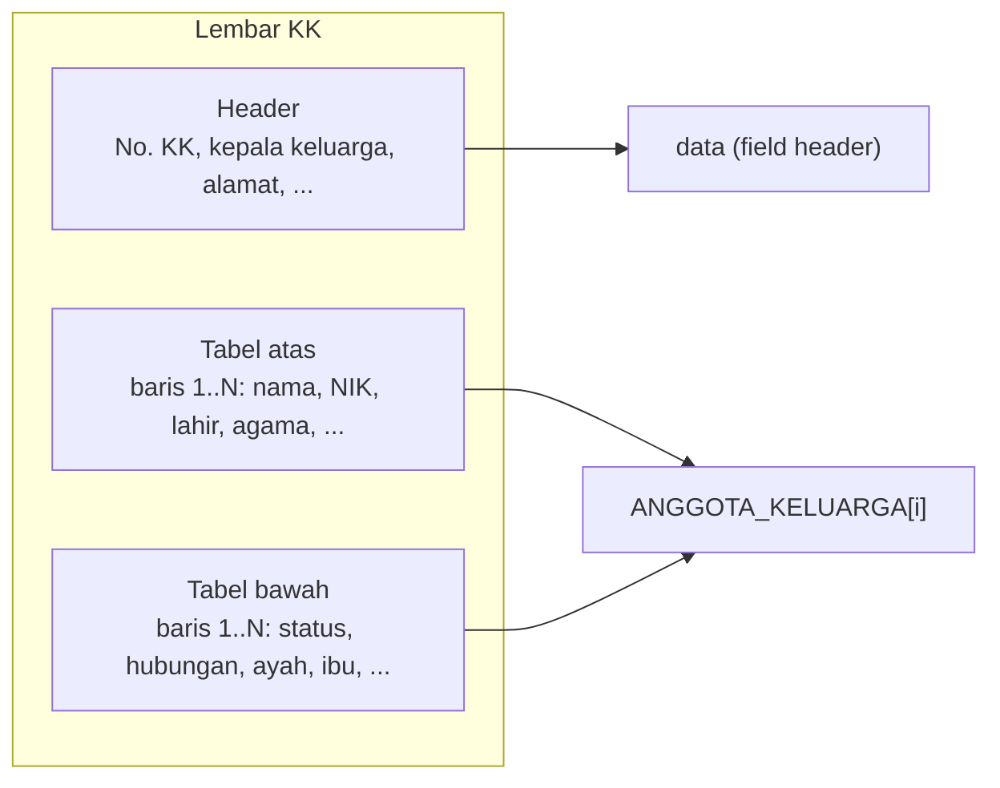

# Kartu Keluarga (KK)

Endpoint: `POST /extract/kk` (multipart) · `POST /extract/kk/base64` (JSON)

Respons KK terdiri dari **field header** dan `ANGGOTA_KELUARGA`, yaitu list berisi satu objek per anggota keluarga. Di lembar KK, data anggota terbagi di dua tabel (atas dan bawah) dengan nomor baris yang sama; API menggabungkan keduanya menjadi satu objek.



## Field header

| Field | Keterangan | Nilai yang diizinkan (mode vLLM) |
|---|---|---|
| `NO_KK` | Nomor KK di bawah judul | Tepat 16 digit |
| `NAMA_KEPALA_KELUARGA` | Nama kepala keluarga | Bebas |
| `ALAMAT` | Baris "Alamat" | Bebas |
| `RT_RW` | Mis. `003/005` | `N/N` s.d. `NNN/NNN` |
| `DESA_KELURAHAN` | Baris "Desa/Kelurahan" | Bebas |
| `KECAMATAN` | Baris "Kecamatan" | Bebas |
| `KABUPATEN_KOTA` | Baris "Kabupaten/Kota" | Bebas |
| `KODE_POS` | Kode pos | Tepat 5 digit |
| `PROVINSI` | Baris "Provinsi" | Bebas |
| `TANGGAL_DIKELUARKAN` | "Dikeluarkan Tanggal" di bagian bawah | Bebas |
| `ANGGOTA_KELUARGA` | List anggota keluarga (lihat di bawah) | — |

## Field anggota (`ANGGOTA_KELUARGA[]`)

| Field | Tabel | Nilai yang diizinkan (mode vLLM) |
|---|---|---|
| `NAMA_LENGKAP` | Atas | Bebas |
| `NIK` | Atas | Tepat 16 digit |
| `JENIS_KELAMIN` | Atas | `LAKI-LAKI`, `PEREMPUAN` |
| `TEMPAT_LAHIR` | Atas | Bebas |
| `TANGGAL_LAHIR` | Atas | `DD-MM-YYYY` |
| `AGAMA` | Atas | Bebas |
| `PENDIDIKAN` | Atas | Bebas |
| `JENIS_PEKERJAAN` | Atas | Bebas |
| `GOLONGAN_DARAH` | Atas | Bebas |
| `STATUS_PERKAWINAN` | Bawah | Bebas |
| `TANGGAL_PERKAWINAN` | Bawah | Bebas |
| `STATUS_HUBUNGAN_DALAM_KELUARGA` | Bawah | Bebas |
| `KEWARGANEGARAAN` | Bawah | Bebas |
| `NO_PASPOR` | Bawah | Bebas |
| `NO_KITAP` | Bawah | Bebas |
| `NAMA_AYAH` | Bawah | Bebas |
| `NAMA_IBU` | Bawah | Bebas |

## Contoh

```bash
curl -H "X-API-Key: <key>" -F "file=@kk.jpg;type=image/jpeg" \
  http://localhost:8070/extract/kk
```

Respons (dipersingkat menjadi satu anggota):

```json
{
  "success": true,
  "data": {
    "NO_KK": "3201012304150007",
    "NAMA_KEPALA_KELUARGA": "BUDI SANTOSO",
    "ALAMAT": "JL MAWAR NO 12",
    "RT_RW": "003/005",
    "DESA_KELURAHAN": "SUKAMAJU",
    "KECAMATAN": "CIBINONG",
    "KABUPATEN_KOTA": "BOGOR",
    "KODE_POS": "16911",
    "PROVINSI": "JAWA BARAT",
    "TANGGAL_DIKELUARKAN": "10-03-2021",
    "ANGGOTA_KELUARGA": [
      {
        "NAMA_LENGKAP": "BUDI SANTOSO",
        "NIK": "3201012301800003",
        "JENIS_KELAMIN": "LAKI-LAKI",
        "TEMPAT_LAHIR": "BOGOR",
        "TANGGAL_LAHIR": "23-01-1980",
        "AGAMA": "ISLAM",
        "PENDIDIKAN": "SLTA/SEDERAJAT",
        "JENIS_PEKERJAAN": "KARYAWAN SWASTA",
        "GOLONGAN_DARAH": "O",
        "STATUS_PERKAWINAN": "KAWIN TERCATAT",
        "TANGGAL_PERKAWINAN": "14-02-2008",
        "STATUS_HUBUNGAN_DALAM_KELUARGA": "KEPALA KELUARGA",
        "KEWARGANEGARAAN": "WNI",
        "NO_PASPOR": "",
        "NO_KITAP": "",
        "NAMA_AYAH": "SUPARMAN",
        "NAMA_IBU": "SUMIATI"
      }
    ]
  },
  "raw_output": "{\"NO_KK\":\"3201012304150007\", ...}"
}
```

## Batas khusus KK

KK berupa lembar A4 dengan teks tabel kecil dan output yang panjang, jadi `documents.py` memberinya batas sendiri:

| | KTP / NPWP | KK |
|---|---|---|
| Piksel gambar maksimum | `1003520` (±1 MP) | `2508800` (±2.5 MP) |
| Token output maksimum | `512` | `3072` |

Karena itu vLLM dijalankan dengan `--max-model-len 8192` dan `max_pixels` `2508800`. KTP/NPWP tetap diperkecil ke `MAX_PIXELS` oleh API sebelum dikirim, jadi kecepatannya tidak berubah.

## Catatan

- **Lebih lambat dari kartu:** ±30 detik untuk KK dengan 3 anggota, bertambah untuk setiap anggota. Set timeout client minimal 60–120 detik.
- **Foto seluruh lembar, tegak, dan tajam.** Teks tabel KK kecil; foto miring atau buram paling sering membuat nilai bergeser ke kolom/baris tetangga.
- Panjang `ANGGOTA_KELUARGA` mengikuti jumlah baris terisi di KK. Baris kosong tidak dikembalikan.
