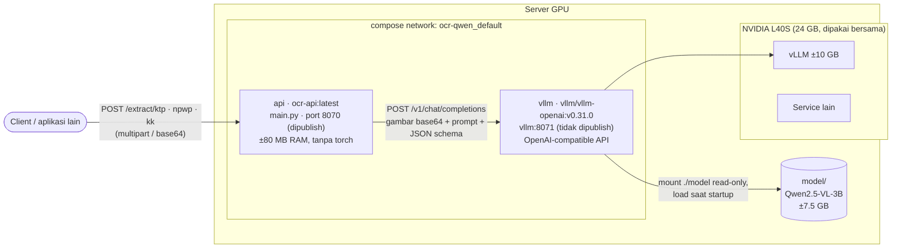
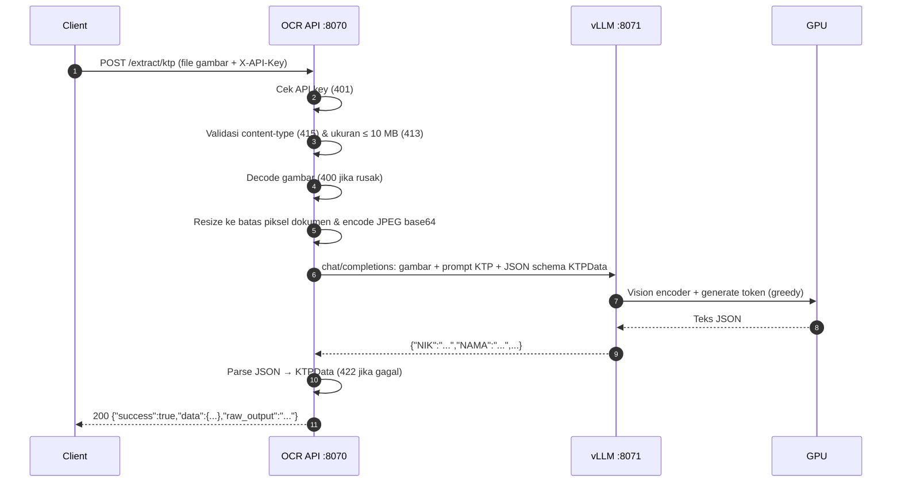
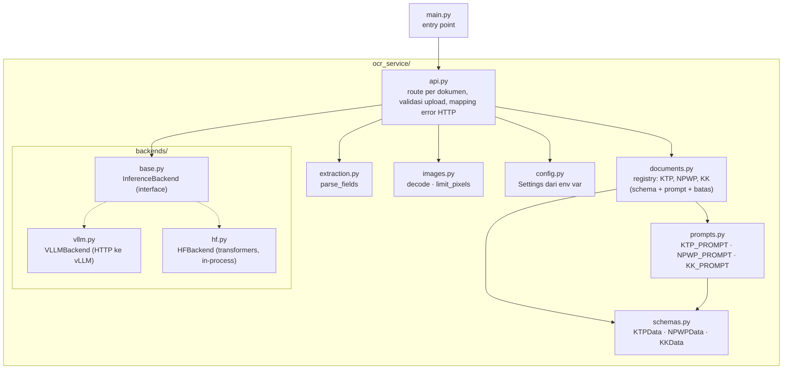

# Arsitektur

## Deployment

Ada dua container dalam satu network compose. API tidak memuat model; semua inference dikirim ke container vLLM, satu-satunya yang memakai GPU.

Poin penting:

- **Port vLLM (8071) tidak dipublish.** Hanya bisa diakses dari dalam network compose (`http://vllm:8071`). Hanya API (port 8070) yang terekspos.
- **vLLM mem-batch request bersamaan**, jadi beberapa request sekaligus selesai hampir secepat satu request.
- **Structured output:** vLLM dipaksa menghasilkan JSON sesuai schema dokumen. Lihat [Prompt & batasan output](/guide/prompt).
- Mode alternatif `hf` memuat model langsung di proses API tanpa vLLM. Lihat [Mode HF](/operasional/screen#mode-hf-tanpa-vllm).

## Alur request

Untuk NPWP dan KK alurnya sama; yang berbeda hanya prompt, schema, dan batasnya:

| Dokumen | Batas piksel gambar | Batas token output |
|---|---|---|
| KTP | `1003520` (±1 MP, `MAX_PIXELS`) | `512` |
| NPWP | `1003520` (±1 MP, `MAX_PIXELS`) | `512` |
| KK | `2508800` (±2.5 MP) | `3072` |

KK berupa lembar A4 dengan teks tabel kecil dan output yang panjang (satu objek per anggota keluarga), sehingga butuh resolusi dan token lebih banyak. Karena itu vLLM dijalankan dengan `--max-model-len 8192`.

## Lapisan kode

Backend dipilih sekali saat startup lewat `INFERENCE_BACKEND`. Backend tidak tahu soal KTP/NPWP/KK; ia hanya menerima gambar, prompt, JSON schema, dan batas token. Karena itu menambah jenis dokumen tidak perlu mengubah backend.
